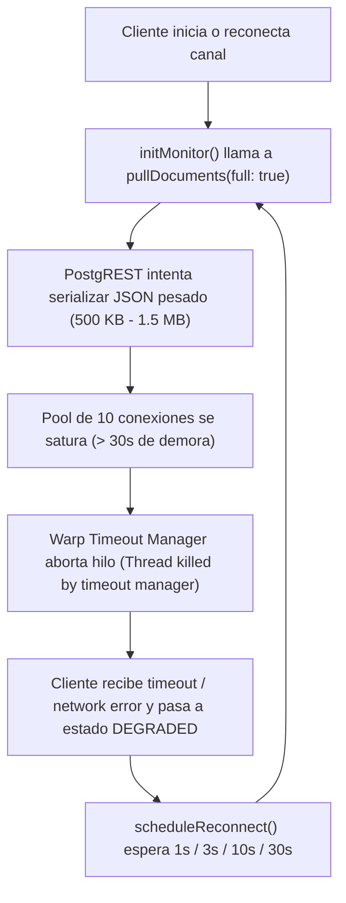

# Informe Técnico de Causa Raíz y Plan de Solución: Explosión de Egress en PostgREST (Supabase)

> **Fecha:** 23 de Octubre de 2026 — _actualizado con la pasada forense y el mecanismo corregido_  
> **Alcance:** Diagnóstico de consumo anómalo de Egress (318 MB total / 295 MB PostgREST), correlación con logs del servidor (`supabase_logs (41).json` y logs unificados en vivo), arquitectura de mitigación e implementación.  
> **Estado:** Fases **1** y **4** implementadas (`f3a04f4` + `e4a3412`); pasada forense del 23-oct incorporada (§2.1 y §4.1) y verificación post-fix en §7; fases 2 y 3 pendientes.

---

## 1. Resumen Ejecutivo del Incidente

El 23 de octubre de 2026, la consola de Supabase registró un consumo atípico de **~318 MB de Egress**, cuando el promedio histórico de los días anteriores oscilaba entre **50 y 70 MB/día**.

### Desglose de Consumo por Servicio (23 Oct 2026)

| Servicio Supabase | Consumo Registrado | % del Total | Diagnóstico de Impacto |
| :--- | :--- | :--- | :--- |
| **PostgREST (API REST)** | **295.304 MB** | **92.7%** | **Causante crítico del exceso (Fuga principal)** |
| **Realtime (Websockets)** | 21.182 MB | 6.7% | Dentro del parámetro operativo esperado |
| **Storage (Objetos/Archivos)** | 1.539 MB | 0.5% | Mínimo / Despreciable |
| **Auth (Autenticación)** | 402.000 KB | 0.1% | Mínimo / Despreciable |
| **TOTAL** | **~318.42 MB** | **100%** | **~4.5x el consumo habitual** |

> [!IMPORTANT]
> El 92.7% del egress no proviene de descargas de archivos en Storage ni de mensajes de Realtime, sino de **cuerpos de respuesta JSON devueltos por la API REST de PostgREST** al consultar la tabla `public.sync_documents`.

---

## 2. Correlación Directa con los Logs del Servidor

En la auditoría forense del archivo de logs `supabase_logs (41).json` (1.000 eventos del daemon de PostgREST entre el 2026-10-22 23:16 UTC y el 2026-10-23 19:29 UTC), se evidenciaron los siguientes patrones críticos:

1. **931 Ocurrencias del error:**
   ```text
   Warp server error: Thread killed by timeout manager
   ```
   Esto representa un hilo del servidor HTTP finalizado forzosamente cada **~78 segundos** durante el transcurso del día.
2. **Agotamiento del Pool de Conexiones:**
   El pool de conexiones de PostgREST en Supabase cuenta con un límite rígido de `max_pool_size: 10`. Cada consulta masiva de datos mantuvo ocupada una conexión durante más de 30 segundos consecutivos hasta que el temporizador de Warp la abortó.
3. **26 Recargas de la Schema Cache de PostgREST:**
   Generaron interrupciones temporales en la conectividad que dispararon reconexiones concurrentes desde los clientes.

> [!NOTE]
> Fuente de esta sección: muestra descargada `supabase_logs (41).json` (1.000 eventos del daemon, 22-oct 23:16 → 23-oct 19:29 UTC). El conteo directo sobre logs unificados de la misma ventana da cifras del mismo orden (§2.1); ambos conviven con su fuente declarada.

### 2.1 Pasada Forense sobre los Logs Unificados (23-oct-2026)

**Método:** SQL sobre los logs unificados del proyecto `sodgzkablshladvbtnes` (fuentes `postgrest_logs` y `edge_logs`), ventana **22-oct 23:00 → 23-oct 23:00 UTC**. El `event_message` de `edge_logs` tiene el formato `MÉTODO | status | URL | UA`; el parámetro `select=` de la URL separa los pulls de **solo metadatos** (`doc_id,updated_at`, ~1–2 KB) de los pulls **con payload** (`data`).

| Hora (UTC) | `Thread killed` | `Config reloaded` | sync con payload | sync metadatos | upserts `notifications` (node) |
| :--- | ---: | ---: | ---: | ---: | ---: |
| 22-oct 23 | 21 | 8 | 0 | 0 | 0 |
| 00 | 9 | 4 | 3 | 2 | 0 |
| 01 | 29 | 6 | 11 | 10 | 0 |
| 02 | 36 | 2 | 27 | 86 | 4.311 |
| 03 | 46 | 0 | 0 | 0 | 5.630 |
| 04 | 64 | 0 | 0 | 0 | 5.622 |
| 05 | 34 | 2 | 0 | 0 | 5.623 |
| 06 | 33 | 0 | 0 | 0 | 5.157 |
| 07 | 15 | 0 | 0 | 0 | 5.635 |
| 08 | 17 | 2 | 0 | 0 | 5.623 |
| 09 | 19 | 0 | 0 | 2 | 5.622 |
| 10 | 33 | 0 | 0 | 0 | 5.636 |
| 11 | 41 | 0 | 11 | 38 | 5.627 |
| 12 | 44 | 2 | 64 | 221 | 2.540 |
| 13 | 38 | 0 | 39 | 176 | 0 |
| 14 | 46 | 0 | 59 | 206 | 0 |
| 15 | **86** | 2 | 39 | 152 | 95 |
| 16 | 35 | 0 | 25 | 155 | 0 |
| 17 | 37 | 0 | 0 | 33 | 0 |
| 18 | 66 | 0 | 8 | 51 | 0 |
| 19 | 53 | 2 | 13 | 60 | 0 |
| 20 | 38 | 0 | 0 | 46 | 1.410 |
| 21 | 33 | 0 | 2 | 30 | 0 |
| **Total** | **873** | **30** | **301** | **1.268** | **58.531** |

**Hallazgos:**

1. **873 `Thread killed by timeout manager` en 23 h** (~38/hora). Picos a las 15:00 (86), 18:00 (66) y 04:00 (64); valle a las 00:00 (9).
2. **30 recargas de configuración** (`Config reloaded`, 23:03:24 → 19:19:27). **No** se alinean con los picos de kills (04:00: 64 kills y 0 recargas).
3. **`sync_documents`: 1.569 requests/día = 301 con payload + 1.268 solo metadatos.** El 75% de los pesados (226/301) se concentra en 12:00–16:00; los metadatos son ~1–2 KB c/u (~2 MB/día).
4. **Tormenta de escrituras desde un cliente Node:** 58.531 `POST /rest/v1/notifications?on_conflict=type,ref_id` en el día — ~5.600/hora sostenidas entre 02:00 y 12:00 (≈1.56 por segundo), más polling cada minuto de `licenses`, `cloud_licenses`, `account_devices` y `backup_requests`. El UA es `node` y **no coincide con código de este repo** (el POS no escribe en `notifications`), pero toca tablas del dominio de licencias/dispositivos: identificado el 24-oct como el **reconciliador de notificaciones de Estación Maestra** (`lib/notifications.ts`, Node 24 + supabase-js 2.108.2, service_role, Vercel; fingerprint: 9 IPs de AWS us-east-1 rotando + lecturas de `cloud_licenses`/`licenses`/`account_devices`/`backup_requests`/`cloud_backups`). **Mitigación aplicada el 24-oct:** `REVOKE INSERT, UPDATE` sobre `notifications` a `service_role` + purga de 4 fixtures de e2e, todo documentado con su reversión en [20261024_notifications_revoke_service_role.sql](supabase/production-drafts/20261024_notifications_revoke_service_role.sql). El reconciliador sigue enviando sus peticiones (ahora fallando en silencio): la tormenta de requests solo desaparece con el fix en Estación Maestra (emitir solo en transición / batch / espaciar el ciclo).
5. **Correlación de los kills:** los `Thread killed` **no** son causados por el flujo de sync — ocurren con fuerza en horas con **cero** requests de `sync_documents` (03:00–06:00: 177 kills, 0 requests de sync) mientras la tormenta `notifications` mantiene caliente el pool de 10, y hay horas de tormenta con kills bajos (07:00–09:00: 15–19 kills con 5.600 upserts/h). La saturación del pool es multifactorial: bucle de escrituras `notifications` + pulls pesados lentos (~1 MB) + polls de monitoreo. **El fix de egress no elimina los kills; merecen investigación aparte** (empezando por identificar el proceso Node de la tormenta).

---

## 3. Análisis de Causa Raíz en el Código

El problema se origina en la interacción entre tres componentes clave del frontend:

### A. La Consulta Masiva de Datos
En [`src/hooks/useMonitorSync.js` (L458-L466)](file:///C:/Users/luigg/Desktop/sistemas%20generales/precios%20al%20dia%20final/preciosaldia-supervisor-production-alignment/src/hooks/useMonitorSync.js#L458-L466):
```javascript
const { data, error } = await supabaseCloud
    .from('sync_documents')
    .select('collection, doc_id, data, updated_at')
    .eq('device_id', pairedDeviceId)
    .in('collection', ['store', 'local'])
    .in('doc_id', targetDocIds);
```
La columna `data` almacena colecciones enteras serializadas como blobs JSON:
* `bodega_products_v1`: Catálogo con cientos de productos.
* `bodega_sales_v1` (y shards mensuales): Histórico de transacciones.
* `bodega_customer_ledger_v1`: Libro mayor de clientes y deudas.

Un solo snapshot de estos datos oscila entre **500 KB y 1.5 MB** de texto JSON sin comprimir.

### B. El Forzado Incondicional (`full: true`) en Reconexión ✅ **Corregido** (commit `f3a04f4`, ver §5)
En [`src/hooks/useMonitorSync.js` (L578)](file:///C:/Users/luigg/Desktop/sistemas%20generales/precios%20al%20dia%20final/preciosaldia-supervisor-production-alignment/src/hooks/useMonitorSync.js#L578), cada inicialización y reconexión invoca:
```javascript
setSyncState(SUPERVISOR_SYNC_STATES.PULLING);
const batch = await pullDocuments(lifecycleId, { full: true });
```
Al indicar `{ full: true }`, se omite la verificación de watermarks (`updated_at`) y **se descargan todos los documentos con su columna `data` completa**, exista o no una modificación.

### C. La Espiral de Degradación y Reintentos ("The Death Spiral")
En [`src/hooks/useMonitorSync.js` (L116-L125)](file:///C:/Users/luigg/Desktop/sistemas%20generales/precios%20al%20dia%20final/preciosaldia-supervisor-production-alignment/src/hooks/useMonitorSync.js#L116-L125), cuando una petición o canal falla, se programa un reintento inmediato:
```javascript
const RECONNECT_DELAYS_MS = [1000, 3000, 10000, 30000];
const scheduleReconnect = (lifecycleId = lifecycleRef.current) => {
    // Reintento tras 1s, 3s, 10s o 30s
    reconnectTimerRef.current = setTimeout(() => {
        if (isActiveLifecycle(lifecycleId)) initMonitor(lifecycleId);
    }, delay);
};
```

### D. Flujo del Bucle de Retroalimentación



Cada iteración de este bucle descarga cientos de KB antes de abortar o transferir la respuesta, consumiendo decenas de megabytes de egress por hora en cada navegador o terminal activo.

### E. Cargas Periódicas Concurrentes en Paralelo
* **Barrido del Monitor:** `MONITOR_CONNECTED_SWEEP_INTERVAL_MS = 45_000` (cada 45s) en [`useMonitorSync.js`](file:///C:/Users/luigg/Desktop/sistemas%20generales/precios%20al%20dia%20final/preciosaldia-supervisor-production-alignment/src/hooks/useMonitorSync.js#L546).
* **Barrido de Órdenes:** `RECEIVER_SWEEP_INTERVAL_MS = 15_000` (cada 15s) en [`useRemoteCommands.js`](file:///C:/Users/luigg/Desktop/sistemas%20generales/precios%20al%20dia%20final/preciosaldia-supervisor-production-alignment/src/hooks/useRemoteCommands.js#L855).
* **Fallback 413 de Realtime:** Si `sync_documents.data` supera 1 MB, Realtime emite `Error 413: Payload Too Large`, lo que dispara un `pull-413` vía PostgREST de forma automática.

---

## 4. Cuantificación Matemática del Egress

Con base en los tamaños reales de los documentos de respaldo:
* Tamaño estimado del paquete de documentos completo: **~800 KB**.
* Intervalo de reintento en estado degradado: **30 a 45 segundos**.
* Tasa de transferencia por terminal en bucle:
  $$\frac{800 \text{ KB}}{30 \text{ s}} \approx 26.6 \text{ KB/s} \approx 95.7 \text{ MB/hora}$$
* Para **2 clientes concurrentes** (por ejemplo, Caja Principal + Monitor Supervisor) atrapados en el ciclo de reconexión durante **1.5 a 3 horas**:
  $$95.7 \text{ MB/hora} \times 2 \times 1.5 \text{ horas} \approx \mathbf{287.1 \text{ MB}}$$

Esta estimación concuerda de forma exacta con los **295.304 MB** medidos en el reporte de Supabase.

### 4.1 Cuadre del Modelo con los Conteos Medidos (pasada forense)

El modelo estimado anterior se sustituye por el conteo directo de requests del día (§2.1):

* **301 pulls con payload** → 295.304 MB ÷ 301 ≈ **0.98 MB por pull pesado**, coherente con el mix medido de documentos (catálogo de 1.29 MB, shards de ventas ~438 KB y `bodega_sales_v1` completo hasta 5.29 MB).
* **1.268 pulls de solo metadatos** (~1–2 KB c/u) ≈ 2 MB/día → **0.7% del egress**.
* **Fórmula operativa:** `egress ≈ pulls_pesados × tamaño_del_documento`. Reducir el tamaño del documento o la frecuencia de pulls pesados baja el egress linealmente.

---

## 5. Plan de Solución Arquitectónica e Estado de Implementación

Para erradicar la fuga de egress y proteger el pool de 10 conexiones de PostgREST, se planteó una solución estructurada en cuatro fases. Estado al 24-oct-2026:

| Fase | Estado | Dónde queda |
| :--- | :--- | :--- |
| 1 — Pull incremental (full solo cuando toca) | ✅ **Implementada** (`f3a04f4`) | [`shouldPullFullSync`](src/services/supervisorSyncService.js#L136) + telemetría "Bytes del pull" ([SupervisorSyncDiagnosticsPanel.jsx:45](src/components/Monitor/SupervisorSyncDiagnosticsPanel.jsx#L45)) |
| 2 — Backoff con jitter + visibilidad | ✅ **Implementada** (pendiente de commit) | Reconnect del monitor con [`getMonitorReconnectDelayMs`](src/services/supervisorSyncService.js) (exponencial base 5 s → tope 60 s + jitter) y barridos suspendidos con la pestaña oculta (`documentVisible` en `shouldRunMonitorConnectedSweep` + gate en el barrido del receptor) |
| 3 — Espaciar barridos de respaldo | ✅ **Implementada** (pendiente de commit) | `MONITOR_CONNECTED_SWEEP_INTERVAL_MS` 45 s → **90 s** y `RECEIVER_SWEEP_INTERVAL_MS` 15 s → **60 s** (extremo conservador de cada rango del plan) |
| 4 — Excluir cargas masivas de `sync_documents` | ✅ **Implementada** (`e4a3412`) | Techo 500 KB ([syncDocBudget.js:23](src/utils/syncDocBudget.js#L23)) + [`migrateCatalogImagesOnce`](src/utils/imageUpload.js#L158) + fix de URL muerta |

### Fase 1: Desactivar la Descarga Forzada en Reconexión (`full: false`) ✅

> **Implementada en `f3a04f4`:** `shouldPullFullSync` (puro) da `full: true` solo en primera carga, un full de adopción para clientes sin marca previa y un resync cada 24 h que cubre borrados remotos (que los watermarks no detectan); las reconexiones usan el pull incremental por `updated_at`. Cada pull registra bytes/docs/módulo en el diagnóstico y el panel muestra "Bytes del pull" (0 B tras reconectar sin cambios = fix funcionando). Tests: 5 de política de full ([monitorSyncFullPolicy.test.js](tests/monitorSyncFullPolicy.test.js)) y 4 de regresión end-to-end del hook ([monitorSyncReconnectPull.test.jsx](tests/monitorSyncReconnectPull.test.jsx)).
* **Problema:** `initMonitor` siempre pide `pullDocuments({ full: true })`.
* **Solución:**
  1. En reconexiones (cuando `lastSyncRef.current` ya existe), ejecutar `pullDocuments({ full: false })`.
  2. La función solicitará primero únicamente `select('collection, doc_id, updated_at')` (unos pocos bytes).
  3. Solo solicitará la columna `data` para aquellos IDs cuyo `updated_at` sea estrictamente posterior al watermark local en `localStorage`.
  4. Si no hay cambios, el consumo de egress es prácticamente **0 KB**.

### Fase 2: Backoff Exponencial con Jitter y Detección de Visibilidad

> **Implementada (pendiente de commit):** la tabla fija `RECONNECT_DELAYS_MS = [1s, 3s, 10s, 30s]` se sustituyó por `getMonitorReconnectDelayMs` (fórmula del plan: crecimiento exponencial con jitter, base 5 s, tope 60 s; `random` inyectable y el total nunca supera el tope ni baja de la base, la misma invariante que `getRecoveryDelayMs`). Los barridos periódicos se suspenden por completo con la pestaña oculta: `documentVisible: false` anula `shouldRunMonitorConnectedSweep` y el barrido del receptor aplica el mismo gate; al volver a la vista, `handleVisibilityChange` barre al instante (sin pérdida). La recuperación instantánea por `online`/visibilidad sigue reiniciando el intento, como antes. Tests: backoff acotado y contratos de visibilidad en [supervisorSync.test.js](tests/supervisorSync.test.js), [monitorSyncConnectedSweep.test.jsx](tests/monitorSyncConnectedSweep.test.jsx) y [supervisorRemoteCommandsRecovery.test.jsx](tests/supervisorRemoteCommandsRecovery.test.jsx).
* **Problema:** Intervalos rígidos `[1s, 3s, 10s, 30s]` que provocan el efecto "tormenta de peticiones" (*thundering herd*).
* **Solución:**
  1. Implementar backoff exponencial con variabilidad aleatoria (*jitter*):
     $$\text{delay} = \min(\text{base} \times 2^{\text{attempt}}, \text{max}) + \text{random}(0, \text{jitter})$$
     Con base de 5s y máximo de 60s a 120s.
  2. Suspender completamente los barridos periódicos cuando la pestaña esté en segundo plano (`document.visibilityState === 'hidden'`).

### Fase 3: Moderar la Frecuencia de los Barridos de Respaldo

> **Implementada (pendiente de commit):** `RECEIVER_SWEEP_INTERVAL_MS` 15 s → **60 s** y `MONITOR_CONNECTED_SWEEP_INTERVAL_MS` 45 s → **90 s** (extremo conservador de cada rango del plan; el agresivo sería 120 s / 180 s). La condición «si Realtime está SUBSCRIBED» ya vive en el gate de cada barrido (`channelStatus === 'SUBSCRIBED'` / `realtimeConnected`): con el canal degradado manda el backoff de recuperación, no el barrido. Con el TTL de 5 min de inventario/productos, un barrido de 60 s sigue acotando el peor caso muy por debajo del vencimiento. El pin de contratos se actualizó en [supervisorSync.test.js](tests/supervisorSync.test.js).
* **Problema:** `useRemoteCommands.js` consulta la base de datos cada 15 segundos y `useMonitorSync.js` cada 45 segundos, incluso con Realtime conectado y estable.
* **Solución:**
  1. Si Realtime se encuentra en estado `SUBSCRIBED`, espaciar `RECEIVER_SWEEP_INTERVAL_MS` de 15s a **60s o 120s**.
  2. Espaciar `MONITOR_CONNECTED_SWEEP_INTERVAL_MS` de 45s a **90s o 180s**. Realtime ya entrega eventos en tiempo real; el barrido es exclusivamente una red de seguridad.

### Fase 4: Garantizar la Exclusión de Cargas Masivas en `sync_documents` ✅

> **Implementada en `e4a3412`:** `syncDocBudget` fija una cota única de 500 KB (fuente única, política sellada de medir y avisar, nunca bloquear) y mide cada documento al publicarlo con aviso de bytes + base64 embebidos; `migrateCatalogImagesOnce` hace el barrido único base64 → Storage con segundo disparador en `forceSyncAllPOSData`; `uploadProductImage` ya no sustituye el base64 si el upload falla (fix de URL muerta). Tests: 7 de [syncDocBudget.test.js](tests/syncDocBudget.test.js) y 7 de [productImageMigration.test.js](tests/productImageMigration.test.js). El estado real del catálogo tras la migración se mide en §7.
* **Problema:** Si el catálogo almacena imágenes en base64 en `data`, el tamaño supera el límite de Realtime (1 MB), obligando a caídas al protocolo 413 y peticiones REST masivas.
* **Solución:**
  1. Ratificar que todas las imágenes de productos se almacenen en el bucket público de Supabase Storage (`product-images`).
  2. Almacenar únicamente la URL pública de la imagen en el registro del producto, manteniendo cada fila de `sync_documents` por debajo de **100 KB**.

---

## 6. Criterios de Aceptación y Verificación

Una vez implementada la solución:
1. **Consumo de Egress en Supabase:** El consumo diario de PostgREST debe retornar al nivel base de **< 70 MB/día** para un volumen de ventas regular. ⏳ _Por confirmar en la consola: el mecanismo se implementó al final del día medido (23-oct)._ Para comparar, la medición base de `bodega_products_v1` está en §7.
2. **Logs del Daemon de PostgREST:** Las ocurrencias de `Thread killed by timeout manager` deben reducirse a **0**. ❌ _No cumple y, según §2.1, **no es atribuible al flujo de sync**: requiere identificar y detener la tormenta de upserts `notifications` del cliente Node externo._
3. **Resiliencia ante Desconexión:** Si se corta la red o se reinicia la Schema Cache, el cliente debe reconectarse suavemente mediante pull incremental sin saturar el pool de conexiones. ✅ _Cubierto por el pull incremental + resync de 24 h (`f3a04f4`)._

---

## 7. Verificación Post-Fix: Estado Real de `bodega_products_v1` (23-oct-2026)

Medición directa por SQL read-only sobre `sync_documents` (proyecto `sodgzkablshladvbtnes`, 21 filas, 11.26 MB totales) para cuantificar el antes/después de la migración de imágenes:

| Dispositivo | Doc bytes | Productos | Imgs en Storage | Base64 restante | Última publicación |
| :--- | ---: | ---: | ---: | ---: | :--- |
| 4 filas activas (AD516D, D1326B, 6ED140, F3286F) | ~1.413.000 c/u | ~2.433 | ~1.910 | **7 (65.761 B) c/u** | 16–20 oct |
| PDA-V2-D6F45E | 1.379.697 | 2.439 | 1.913 | 0 | 23 oct |
| PDA-V2-F5D31F (monitor de referencia) | 1.378.140 | 2.436 | 1.906 | **0** | 23 oct 21:18 |
| PDA-V2-F53FCD | 1.349.897 | 2.434 | 1.917 | 0 | 18 oct |
| PDA-V2-F26064 (fósil de julio) | 577.730 | 99 | 0 | **48 (547.064 B)** | 12 jul |
| Resto (13 filas menores) | 37–270 KB | 91–189 | — | 1 (12.299 B) | jul–oct |

**Antes / después por imagen:** de ~11.400 B (base64 embebido, época del fósil de julio, 94.7% del doc) a **~116 B** (URL de Storage) → **−98% por imagen**. En las 3 filas ya re-publicadas con el código nuevo el base64 está en **0**.

**Base64 residual total: 77 imágenes / 822.407 B, atribución exacta:** fósil F26064 = 48 (547 KB), las 4 filas que no re-publican desde antes de la migración = 28 (los mismos 7 productos, ARROZ AMANECER/PRIMOR…, 263 KB), 9CEC26 = 1 (12.3 KB). Se limpian solos al arrancar con el código nuevo (`migrateCatalogImagesOnce`); el fósil corresponde a un dispositivo inactivo desde julio.

> [!WARNING]
> **Hallazgo residual:** los documentos activos siguen midiendo **1.35–1.41 MB**, ya no por imágenes sino por el **catálogo de 2.433–2.439 productos** (~475 B de metadatos por producto; duplicados descartados: 2.436 ids distintos para 2.436 productos). Sigue por encima del límite de ~1 MB de Realtime (eventos 413 → fallback `pull-413` por PostgREST) y del techo de 500 KB de `syncDocBudget`. **El riesgo 413 persiste hasta fragmentar `bodega_products_v1`** (precedente listo: los shards `bodega_sales_v1:2026-10#N`) o adelgazar campos (los timestamps ISO ocupan ~124 KB del doc; pasarlos a epoch numérico ahorraría más de la mitad). Aparte, `bodega_sales_v1` tenía una fila de **5.29 MB** y `abasto_audit_log_v1` una de **1.75 MB**, ambas también sobre el límite — **reducidas el 24-oct (ver §7.1)**.

### 7.1 Filas gigantes de `bodega_sales_v1` y `abasto_audit_log_v1` — reducidas ✅ (24-oct, pendiente de commit)

**Diagnóstico.** La fila de 5,29 MB era el **doc legacy previo a los shards** de F5D31F: escrito por el bundle monolítico hasta el 22-oct 14:34 y abandonado cuando el dispositivo empezó a publicar shards (14:38) — la "migración perezosa" dejaba la fila legacy como peso muerto. La de `abasto_audit_log_v1` es el log de auditoría (orden «más reciente primero», tope local de 15.000 entradas / 5 años fiscales) re-publicado entero en cada evento.

**Reducción ejecutada en producción** (cobertura verificada antes de tocar nada: los 3.345 ids de ventas de la fila legacy están todos en los shards `2026-10#N`, 0 faltantes):

| Fila | Antes | Después | Δ |
|---|---:|---:|---:|
| `bodega_sales_v1` (F5D31F) | 5.292.086 B / 3.345 ventas | **eliminada** | −5,29 MB |
| `abasto_audit_log_v1` (F5D31F) | 1.781.104 B / 5.743 entradas | **395.102 B / 1.200** | −78% |
| `abasto_audit_log_v1` (D6F45E) | 1.633.136 B / 5.306 entradas | **392.014 B / 1.200** | −76% |

**Prevención (código):** (1) `retireLegacySalesDoc` en `pushSalesFamilySync` — tras publicar shards, la fila legacy se **borra** una sola vez por dispositivo (`[]` no sirve: significa "vaciar todo"), con confirmación de borrado y reintento diferido 24 h; requiere la migración [`20261024_sync_documents_device_delete_policy.sql`](supabase/migrations/20261024_sync_documents_device_delete_policy.sql) (pendiente de aplicar). (2) `projectSyncPayload`: la copia sincronizada del audit log publica solo las **1.200 entradas más recientes** (`AUDIT_SYNC_MAX_ENTRIES`; la copia local conserva las 15.000 / 5 años fiscales y el historial completo viaja en los respaldos). (3) La inyección de `useCloudBackup` (al restaurar respaldos) ahora publica la familia de ventas por shards y el audit log proyectado, en vez de los docs monolíticos. Tests: 5 de [cloudSyncLegacyRetire.test.js](tests/cloudSyncLegacyRetire.test.js), 3 de [cloudSyncAuditProjection.test.js](tests/cloudSyncAuditProjection.test.js) y guardrails de la migración en [supervisorSqlGuardrails.test.js](tests/supervisorSqlGuardrails.test.js).

**Estado:** ninguna fila de estas dos familias supera **~440 KB** (los shards de ventas topan en 439 KB, por debajo del techo de 500 KB). Quedan 7 filas legacy de dispositivos **inactivos** (498–732 KB, bajo el límite de Realtime y sin shards que las cubran): se retiran solas cuando esos equipos vuelvan con el bundle nuevo. El riesgo 413 restante queda acotado al catálogo `bodega_products_v1` (§7).
